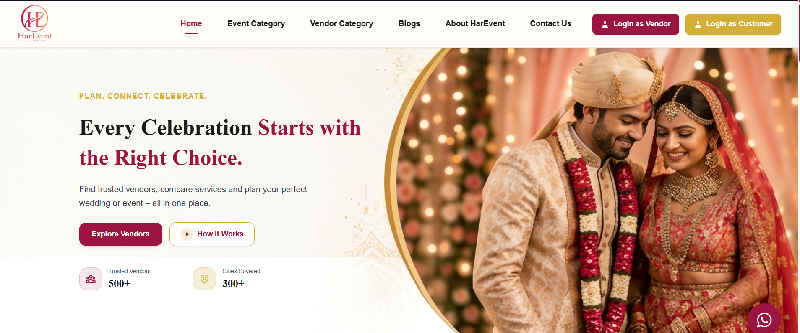

# HarEvent

HarEvent is a modern wedding and event planning marketplace built with React and Vite. It helps users discover trusted vendors, explore event categories, compare options, and connect directly with service providers for weddings, birthdays, corporate events, and more.

The project is designed as a polished, responsive landing and browsing experience with category pages, vendor discovery, blog content, FAQ sections, and WhatsApp-based inquiry flows.

## Preview



## Features

- Elegant wedding/event landing page with premium branding
- Vendor category browsing for venues, photographers, decorators, caterers, and more
- Event category pages for weddings, birthday parties, corporate functions, and special occasions
- Direct WhatsApp contact links for fast customer inquiry
- Blog and informational content for planning inspiration
- Responsive design optimized for mobile, tablet, and desktop
- Clean navigation with React Router for multiple pages

## Tech Stack

- React 19
- Vite
- React Router DOM
- Tailwind CSS
- Lucide React
- React Icons

## Project Structure

```bash
harevent/
├── public/
│   ├── logo.png
│   ├── couple.png
│   ├── weddings.webp
│   └── ...
├── src/
│   ├── components/
│   ├── pages/
│   ├── App.jsx
│   ├── main.jsx
│   ├── index.css
│   └── App.css
├── .gitignore
├── eslint.config.js
├── index.html
├── package.json
├── vite.config.js
├── README.md
└── package-lock.json
```

## Main Pages

- Home
- Event Category
- Vendor Category
- Blogs
- About HarEvent
- Contact Us
- 404 Not Found page

## Prerequisites

Before running the project, make sure you have installed:

- Node.js (v18 or above recommended)
- npm

## Getting Started

1. Clone the repository:

```bash
git clone <repository-url>
cd HarEvent
```

2. Install dependencies:

```bash
npm install
```

3. Start the development server:

```bash
npm run dev
```

5. Open the local URL shown in the terminal (usually `http://localhost:5173`).

## Available Scripts

```bash
npm run dev
```
Runs the project in development mode.

```bash
npm run lint
```
Runs ESLint checks across the codebase.


## Deployment

This project is a frontend React app and can be deployed easily on platforms such as:

- Vercel
- Netlify
- GitHub Pages
- Any static hosting provider

## Notes

- The website includes direct WhatsApp enquiry buttons for customer and vendor interaction.
- The app is intentionally designed for a wedding/event marketplace experience with a premium, luxury aesthetic.
- The project currently does not include a backend or database; it is a frontend-focused experience.

## License

This project does not yet include a specific license file. If you plan to publish or distribute it publicly, add an appropriate license before release.

## Contact

For project-related questions or business inquiries, use the contact or WhatsApp flow available within the app.
